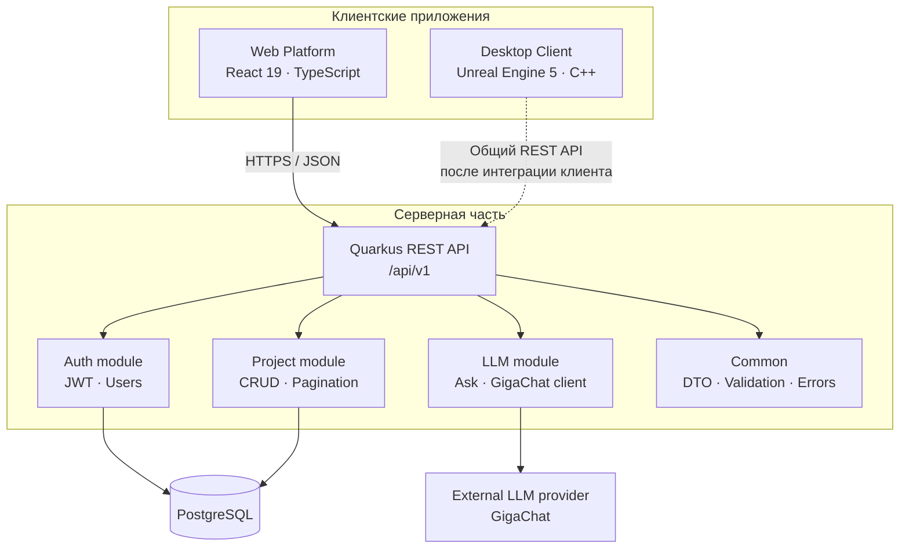
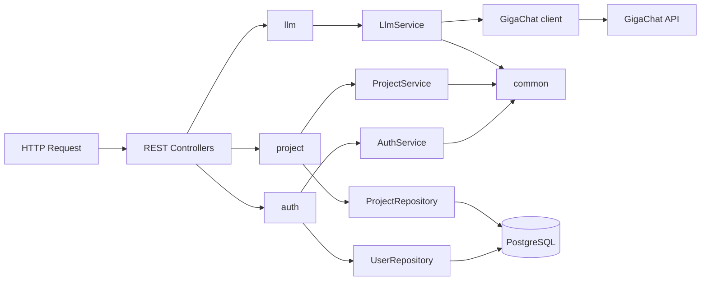
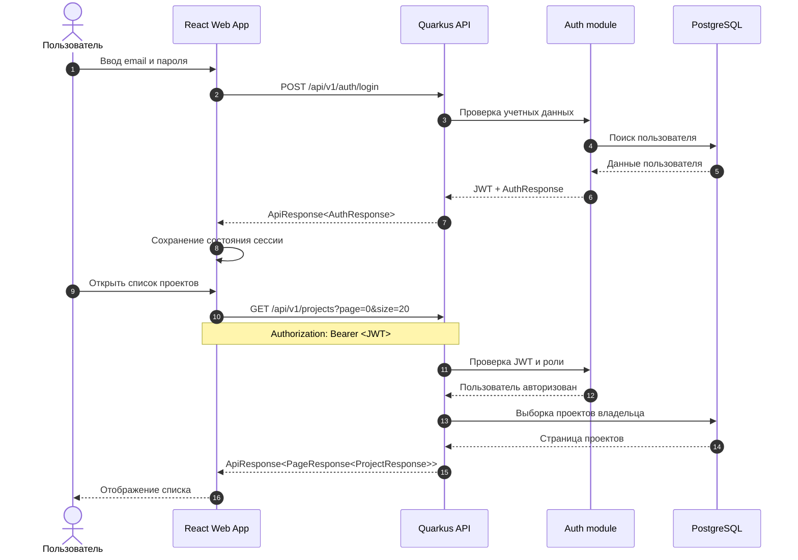
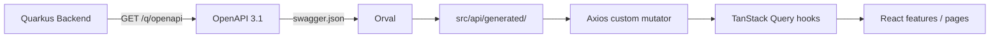

<div align="center">

# 🚄 RailOptima

### Railway infrastructure design & project management platform

**Единая экосистема для управления проектами железнодорожной инфраструктуры, инженерной 3D-визуализации и интеллектуальной помощи.**

<p>
  
  
  
  
  
</p>

<p>
  <a href="#-о-проекте">О проекте</a> ·
  <a href="#-архитектура">Архитектура</a> ·
  <a href="#-api-контракт">API</a> ·
  <a href="#-технологический-стек">Стек</a> ·
  <a href="#-запуск-проекта">Запуск</a> ·
  <a href="#-roadmap">Roadmap</a>
</p>

</div>

---

## 📌 Содержание

- [О проекте](#-о-проекте)
- [Ключевые возможности](#-ключевые-возможности)
- [Архитектура](#-архитектура)
- [Взаимодействие компонентов](#-взаимодействие-компонентов)
- [API-контракт](#-api-контракт)
  - [Сводная таблица эндпоинтов](#сводная-таблица-эндпоинтов)
  - [Аутентификация](#1-аутентификация)
  - [Проекты](#2-проекты)
  - [LLM-помощник](#3-llm-помощник)
  - [Формат ответа](#формат-ответа-api)
- [Технологический стек](#-технологический-стек)
- [Структура монорепозитория](#-структура-монорепозитория)
- [Быстрый старт](#-запуск-проекта)
- [OpenAPI и генерация клиента](#-openapi-и-генерация-клиента)
- [Конфигурация](#-конфигурация)
- [Безопасность и целостность данных](#-безопасность-и-целостность-данных)
- [Проверки и качество кода](#-проверки-и-качество-кода)
- [Roadmap](#-roadmap)
- [Статус проекта и ограничения](#-статус-проекта-и-ограничения)

---

## 🚆 О проекте

**RailOptima** — разрабатываемая программная платформа для создания и сопровождения проектов железнодорожной инфраструктуры. Она объединяет несколько клиентских приложений с единым серверным API и хранилищем данных.

Проект развивается в формате **Monorepo** и включает три основных направления:

| Компонент | Роль в системе | Технологии |
|---|---|---|
| **Web Platform** | Пользовательский интерфейс, учётные записи, управление проектами и AI-чат | React, TypeScript, Vite |
| **Backend API** | Авторизация, бизнес-логика, хранение данных и интеграция с LLM | Java, Quarkus, PostgreSQL |
| **Desktop Client** | Отдельное инженерное приложение для 3D-проектирования и визуализации | Unreal Engine 5, C++ |

Главный архитектурный принцип — **единый контракт данных и API для разных клиентских приложений**. Веб-клиент уже использует REST API для работы с аккаунтами, проектами и LLM. Десктопный клиент развивается параллельно; подключение его сетевого слоя к общему API следует рассматривать как отдельный этап интеграции, а не как уже завершённую возможность.

### Цели платформы

- Собрать инструменты работы с проектом железнодорожной инфраструктуры в одном программном пространстве.
- Разделить пользовательский интерфейс, серверную бизнес-логику и инженерную 3D-среду.
- Обеспечить общее серверное хранилище для клиентских приложений.
- Создать основу для инженерных расчётов, сравнения вариантов трасс и работы с проектными данными.
- Добавить интеллектуального помощника для естественно-языкового взаимодействия с информацией.

## ✨ Ключевые возможности

### 🌐 Web Platform

- Регистрация и вход по email и паролю.
- JWT-аутентификация и защищённые маршруты.
- Создание, просмотр, изменение и удаление проектов через REST API.
- Постраничная загрузка списка проектов.
- Статусы проекта: `CREATED`, `IN_PROGRESS`, `COMPLETED`.
- Dashboard и страницы управления проектами.
- AI-чат с отправкой вопросов в backend.
- Генерация TypeScript API-клиента по OpenAPI через Orval.
- Формы с React Hook Form и Zod.
- Клиентское состояние через Zustand и серверное состояние через TanStack Query.
- Светлая и тёмная темы интерфейса.

### 🖥️ Desktop Client

Десктопное направление разрабатывается на **Unreal Engine 5 и C++** как отдельный инженерный клиент.

Целевые области развития:

- 3D-представление проектируемых объектов и рельефа.
- Инструменты работы с геометрией железнодорожной трассы.
- Исследование вариантов прохождения трассы.
- Анализ влияния рельефа и продольных уклонов.
- Инженерные вычисления и оценка проектных вариантов.
- Обмен данными с Web Platform через общий backend API.

> Конкретный набор доступных инструментов зависит от текущей версии Unreal-проекта. Наличие отдельного клиента не означает, что все перечисленные инженерные функции уже реализованы.

### ⚙️ Backend API

- REST API с префиксом `/api/v1`.
- Регистрация и выдача JWT.
- Управление проектами пользователя.
- DTO-валидация и централизованный формат API-ответов.
- PostgreSQL для постоянного хранения данных.
- Flyway для версионирования схемы БД.
- OpenAPI 3.1 для описания HTTP-контракта.
- Health endpoint для проверки состояния приложения.
- LLM-интеграция через серверный сервис, в текущем проектном контексте — GigaChat.

---

## 🏗️ Архитектура

RailOptima использует клиент-серверную архитектуру с несколькими клиентами и общим backend. Серверная часть организована как модульное приложение: функциональность разделяется по доменным областям без преждевременного перехода к микросервисам.

### Общая схема системы



**Как читать схему:** Web Platform вызывает доступные API-маршруты. Backend проверяет входные данные, применяет правила доступа, выполняет бизнес-операции и обращается к PostgreSQL или внешнему LLM-провайдеру. Unreal Engine — самостоятельный клиент; для него предполагается использование того же REST-контракта, а не отдельной копии серверной логики.

### Модульная структура backend



| Модуль | Ответственность |
|---|---|
| `auth` | Регистрация, вход, сущность пользователя, репозиторий и выдача JWT |
| `project` | CRUD проектов, принадлежность проекту владельцу, пагинация |
| `llm` | Приём вопросов, вызов сервиса LLM и формирование ответа |
| `common` | Общие DTO, типизированные исключения, формат ответов и обработка ошибок |

### Поток авторизации и работы с проектом



### Контрактная генерация API-клиента



OpenAPI выступает контрактом между сервером и веб-клиентом. Параметр `format=json` поддерживается Quarkus SmallRye OpenAPI; см. [официальное руководство Quarkus](https://quarkus.io/guides/openapi-swaggerui). После изменения DTO или маршрутов спецификацию нужно обновить и повторно запустить генерацию. Файлы внутри `src/api/generated/` не следует редактировать вручную.

---

## 🔌 API-контракт

**Base URL локальной разработки:** `http://localhost:8080`  
**Префикс бизнес-API:** `/api/v1`  
**Формат обмена:** JSON  
**Описание API:** `http://localhost:8080/q/openapi`  
**Swagger UI:** `http://localhost:8080/q/swagger-ui`

Ниже приведены маршруты из OpenAPI-спецификации RailOptima, полученной от запущенного Quarkus-приложения. Это не предполагаемые REST-маршруты, а текущий опубликованный контракт.

### Сводная таблица эндпоинтов

| Метод | Endpoint | Назначение | Авторизация по OpenAPI |
|---|---|---|---|
| `POST` | `/api/v1/auth/register` | Регистрация пользователя | Не требуется в спецификации |
| `POST` | `/api/v1/auth/login` | Вход и получение JWT | Не требуется в спецификации |
| `GET` | `/api/v1/projects?page=0&size=20` | Получение проектов текущего пользователя | Bearer JWT, роль `USER` |
| `POST` | `/api/v1/projects` | Создание проекта | Bearer JWT, роль `USER` |
| `GET` | `/api/v1/projects/{id}` | Получение одного проекта | Bearer JWT, роль `USER` |
| `PUT` | `/api/v1/projects/{id}` | Обновление проекта | Bearer JWT, роль `USER` |
| `DELETE` | `/api/v1/projects/{id}` | Удаление проекта | Bearer JWT, роль `USER` |
| `POST` | `/api/v1/llm/ask` | Отправка вопроса LLM-помощнику | В текущем OpenAPI security requirement не указан |

`{id}` — UUID проекта. Защищённые запросы к проектам передают токен в заголовке:

```http
Authorization: Bearer <JWT>
Content-Type: application/json
```

### 1. Аутентификация

#### `POST /api/v1/auth/register`

Создание учетной записи.

**Request body — `RegisterRequest`:**

```json
{
  "email": "user@example.com",
  "password": "secure-password"
}
```

Ограничения из OpenAPI:

| Поле | Правила |
|---|---|
| `email` | Обязательное, строка, максимум 150 символов |
| `password` | Обязательное, строка от 6 до 100 символов |

#### `POST /api/v1/auth/login`

Проверка учетных данных и получение токена доступа.

**Request body — `LoginRequest`:**

```json
{
  "email": "user@example.com",
  "password": "secure-password"
}
```

**Response data — `AuthResponse`:**

```json
{
  "token": "<jwt-token>",
  "userId": "7de4c311-95a2-4c3a-ae2a-7b4d461bf4c4",
  "email": "user@example.com",
  "role": "USER"
}
```

Допустимые роли, описанные контрактом: `USER`, `ADMIN`.

### 2. Проекты

Все операции этого раздела в опубликованной спецификации защищены Bearer JWT и ролью `USER`.

#### `GET /api/v1/projects`

Получение списка проектов текущего пользователя с пагинацией.

**Query-параметры:**

| Параметр | Тип | По умолчанию | Описание |
|---|---|---:|---|
| `page` | integer | `0` | Номер страницы, начиная с нуля |
| `size` | integer | `20` | Количество элементов на странице |

Пример:

```http
GET /api/v1/projects?page=0&size=20
Authorization: Bearer <JWT>
```

**Структура `PageResponse<ProjectResponse>`:**

```json
{
  "content": [
    {
      "id": "7de4c311-95a2-4c3a-ae2a-7b4d461bf4c4",
      "name": "North–South railway corridor",
      "description": "Preliminary route project",
      "status": "CREATED",
      "ownerId": "ce245d0c-2d6f-4b92-b81f-88a683eaf377",
      "createdAt": "2026-10-31T10:15:30Z",
      "updatedAt": "2026-10-31T10:15:30Z"
    }
  ],
  "pageNumber": 0,
  "pageSize": 20,
  "totalElements": 1,
  "totalPages": 1,
  "last": true
}
```

#### `POST /api/v1/projects`

Создание нового проекта.

**Request body — `ProjectCreateRequest`:**

```json
{
  "name": "North–South railway corridor",
  "description": "Preliminary route project"
}
```

Ограничения: `name` обязателен и ограничен 100 символами; `description` необязателен и ограничен 500 символами.

#### `GET /api/v1/projects/{id}`

Получение проекта по UUID. Возвращает `ApiResponse<ProjectResponse>`.

```http
GET /api/v1/projects/7de4c311-95a2-4c3a-ae2a-7b4d461bf4c4
Authorization: Bearer <JWT>
```

#### `PUT /api/v1/projects/{id}`

Обновление проекта по UUID.

**Request body — `ProjectUpdateRequest`:**

```json
{
  "name": "North–South railway corridor — revised",
  "description": "Updated project description",
  "status": "IN_PROGRESS"
}
```

`name` и `status` обязательны. `description` необязателен. Допустимые статусы:

| Значение | Смысл |
|---|---|
| `CREATED` | Проект создан |
| `IN_PROGRESS` | Проект находится в работе |
| `COMPLETED` | Проект завершён |

#### `DELETE /api/v1/projects/{id}`

Удаление проекта по UUID.

```http
DELETE /api/v1/projects/7de4c311-95a2-4c3a-ae2a-7b4d461bf4c4
Authorization: Bearer <JWT>
```

### 3. LLM-помощник

#### `POST /api/v1/llm/ask`

Отправка текстового вопроса серверному LLM-сервису.

**Request body — `AskRequest`:**

```json
{
  "question": "Какие параметры следует учитывать при предварительном анализе железнодорожной трассы?"
}
```

`question` — обязательная строка длиной до 2000 символов.

**Response data — `AskResponse`:**

```json
{
  "answer": "При предварительном анализе обычно рассматривают ..."
}
```

В текущей реализации запрос проходит через backend-сервис и клиент внешнего провайдера GigaChat. Секреты провайдера и получение OAuth-токена должны оставаться на серверной стороне — frontend не должен обращаться к ним напрямую.

### Формат ответа API

Для типизированных ответов используется общий envelope `ApiResponse<T>`:

```json
{
  "success": true,
  "message": "Request completed",
  "data": {},
  "timestamp": "2026-10-31T10:15:30Z",
  "path": "/api/v1/example"
}
```

| Поле | Назначение |
|---|---|
| `success` | Признак успешного выполнения |
| `message` | Сообщение о результате |
| `data` | Полезная нагрузка конкретного endpoint |
| `timestamp` | Время формирования ответа в формате date-time |
| `path` | Путь обработанного запроса |

Тип `data` зависит от операции: `AuthResponse`, `ProjectResponse`, `PageResponse<ProjectResponse>` или `AskResponse`.

### Проверка API вручную

Регистрация:

```bash
curl -X POST http://localhost:8080/api/v1/auth/register \
  -H 'Content-Type: application/json' \
  -d '{"email":"user@example.com","password":"secure-password"}'
```

Вход:

```bash
curl -X POST http://localhost:8080/api/v1/auth/login \
  -H 'Content-Type: application/json' \
  -d '{"email":"user@example.com","password":"secure-password"}'
```

Список проектов (подставь токен из ответа login):

```bash
curl 'http://localhost:8080/api/v1/projects?page=0&size=20' \
  -H 'Authorization: Bearer <JWT>'
```

Вопрос LLM:

```bash
curl -X POST http://localhost:8080/api/v1/llm/ask \
  -H 'Content-Type: application/json' \
  -d '{"question":"Расскажи о факторах выбора трассы"}'
```

---

## 🧰 Технологический стек

Версии ниже отражают конфигурацию проекта, известную на момент подготовки этого README. Версии Unreal Engine и PostgreSQL намеренно не детализируются до minor-релиза, поскольку точные значения не подтверждены.

### ⚙️ Backend — Java / Quarkus

<p>
  
</p>

| Технология | Версия / компонент | Использование |
|---|---|---|
| Java | 25 | Основной язык backend |
| Quarkus | 3.40.1.1 | REST API, DI, конфигурация и runtime |
| Gradle | 9.8.2 | Сборка, зависимости, Gradle Kotlin DSL |
| Hibernate Reactive Panache | Quarkus extension | Реактивный слой доступа к данным |
| Reactive PostgreSQL Client | Quarkus extension | Реактивное взаимодействие с PostgreSQL |
| Mutiny | Quarkus ecosystem | Асинхронные операции и `Uni` |
| PostgreSQL | 18 в исходной Compose-конфигурации | Реляционное хранилище |
| Flyway | Quarkus extension | Версионирование и применение миграций |
| Hibernate Validator | Quarkus extension | Валидация DTO и ограничений |
| SmallRye JWT | Quarkus extension | Проверка JWT и авторизация |
| SmallRye Health | Quarkus extension | Health checks |
| SmallRye OpenAPI | Quarkus extension | Генерация OpenAPI 3.1 |
| REST Client | Quarkus extension | Вызов внешних HTTP API |

**Архитектурный акцент:** бизнес-логика backend сосредоточена в Quarkus-приложении. Доступ к данным и внешним сервисам выполняется через серверные сервисы и репозитории, а клиенты получают только публичный REST-контракт.

### 🌐 Frontend — React / TypeScript

<p>
  
</p>

| Технология | Версия | Использование |
|---|---:|---|
| React | 19.3.1 | Компонентный UI |
| TypeScript | 7.0.2 | Типизация приложения |
| Vite | 8.3.5 | Dev server и production build |
| Tailwind CSS | 4.3.3 | Utility-first стилизация |
| TanStack Router | 1.170.46 | Маршрутизация |
| TanStack Query | 5.105.1 | Серверное состояние и запросы |
| Zustand | 5.0.16 | Клиентское глобальное состояние |
| React Hook Form | 7.91.0 | Управление формами |
| Zod | 4.6.7 | Схемы и валидация данных |
| Axios | 1.21.0 | HTTP-клиент и общий mutator |
| Motion | 14.9.0 | UI-анимации |
| Orval | 8.46.0 | Генерация API-клиента из OpenAPI |
| Oxlint | 1.90.0 | Статический анализ и линтинг |
| pnpm | 12.11.2 | Package manager |

**Разделение состояния:** TanStack Query отвечает за данные, получаемые с сервера, Zustand — за локальное глобальное состояние интерфейса. Формы валидируются схемами Zod и связываются с React Hook Form.

### 🖥️ Desktop — Unreal Engine

<p>
  
</p>

| Технология | Использование |
|---|---|
| Unreal Engine 5 | Десктопная 3D-среда |
| C++ | Логика приложения и инженерные модули |

Desktop Client развивается отдельно от React-приложения. Обмен с backend должен строиться через REST/JSON и общий контракт `/api/v1`; отдельный desktop namespace в текущей OpenAPI-спецификации отсутствует.

### 🛠️ Инструменты разработки

<p>
  
</p>

- **Git** — контроль версий.
- **GitHub** — хостинг репозитория и место для CI/CD.
- **Docker Compose** — локальное окружение PostgreSQL.
- **IntelliJ IDEA** — backend-разработка.
- **VS Code** — frontend-разработка.

---

## 📂 Структура монорепозитория

Ниже показано логическое разделение проекта. Фактическое имя каталога Unreal-проекта и отдельные конфигурационные файлы могут отличаться в рабочей копии.

```text
RailOptima/
│
├── Backend/
│   └── src/main/
│       ├── java/api/
│       │   ├── auth/
│       │   │   ├── controller/
│       │   │   ├── dto/
│       │   │   ├── model/
│       │   │   ├── repository/
│       │   │   ├── security/
│       │   │   └── service/
│       │   ├── project/
│       │   │   ├── controller/
│       │   │   ├── dto/
│       │   │   ├── model/
│       │   │   ├── repository/
│       │   │   └── service/
│       │   ├── llm/
│       │   │   ├── client/
│       │   │   ├── config/
│       │   │   ├── controller/
│       │   │   └── service/
│       │   └── common/
│       │       ├── dto/
│       │       ├── exception/
│       │       └── ...
│       └── resources/
│           ├── application.yml
│           └── db/migration/
│
├── Frontend/
│   ├── src/
│   │   ├── api/generated/
│   │   ├── components/
│   │   │   ├── layout/
│   │   │   └── ui/
│   │   ├── features/
│   │   │   ├── auth/
│   │   │   ├── landing/
│   │   │   ├── llm/
│   │   │   └── projects/
│   │   ├── lib/
│   │   ├── pages/
│   │   ├── routing/
│   │   └── store/
│   ├── package.json
│   ├── pnpm-lock.yaml
│   └── vite.config.ts
│
├── Desktop/                    # Unreal Engine 5 project (проверь фактическое имя каталога)
│
├── build.gradle.kts
├── settings.gradle.kts
├── gradlew
├── gradlew.bat
├── docker-compose.yml
├── .env.example
├── .gitignore
└── README.md
```

### Backend package map

| Путь | Назначение |
|---|---|
| `api.auth.controller` | HTTP-эндпоинты регистрации и входа |
| `api.auth.service` | Бизнес-логика аутентификации |
| `api.auth.repository` | Доступ к пользователям |
| `api.auth.security` | JWT и связанные security-компоненты |
| `api.project.controller` | REST-операции над проектами |
| `api.project.service` | Бизнес-логика проектов |
| `api.project.repository` | Доступ к проектам |
| `api.llm.controller` | Endpoint для запроса к AI-помощнику |
| `api.llm.service` | Оркестрация LLM-запроса |
| `api.llm.client` | HTTP-клиент провайдера |
| `api.common.dto` | Общие DTO и envelope-ответы |
| `api.common.exception` | Исключения и exception mappers |

---

## 🚀 Запуск проекта

### Требования

Для Vite 8 требуется Node.js `20.19+` или `22.12+`; отдельные шаблоны и зависимости могут предъявлять более высокие требования. См. [официальное руководство Vite](https://vite.dev/guide/).

| Инструмент | Версия |
|---|---|
| JDK | 25 |
| Gradle Wrapper | Из репозитория; проект использует Gradle 9.8.2 |
| Node.js | `20.19+` или `22.12+` |
| pnpm | 12.11.2 |
| Docker + Compose | Для контейнерного запуска PostgreSQL |
| Git | Последняя стабильная версия |

### 1. Клонирование репозитория

```bash
git clone <repository-url>
cd RailOptima
```

### 2. Подготовка переменных окружения

```bash
cp .env.example .env
```

Заполни параметры подключения к PostgreSQL и секреты интеграций. Реальный `.env` не должен попадать в Git.

### 3. Запуск PostgreSQL

Если в корне репозитория настроен Compose-файл:

```bash
docker compose up -d

docker compose ps
```

Убедись, что PostgreSQL доступен по адресу и credentials, указанным в конфигурации backend.

### 4. Запуск Quarkus Backend

Из корня монорепозитория:

```bash
./gradlew quarkusDev
```

Quarkus Dev Mode запускает приложение с live reload. По текущей конфигурации HTTP-порт — `8080`.

Проверка состояния:

```bash
curl -i http://localhost:8080/q/health
```

OpenAPI:

```bash
curl -fsS 'http://localhost:8080/q/openapi?format=json' -o swagger.json
```

Swagger UI:

```text
http://localhost:8080/q/swagger-ui
```

### 5. Установка зависимостей frontend

В отдельном терминале:

```bash
cd Frontend
pnpm install --frozen-lockfile
```

### 6. Синхронизация API-контракта

При запущенном backend получи актуальную OpenAPI-спецификацию и сгенерируй клиент:

```bash
pnpm api:sync
```

Команда синхронизации должна использовать Quarkus endpoint `http://localhost:8080/q/openapi?format=json`, а не старый Spring Boot путь `/v3/api-docs`. Параметр `format=json` важен, потому что Orval-конфигурация проекта указывает на `swagger.json`.

Если `api:sync` ещё не обновлён в `package.json`, его команда должна выглядеть так:

```json
{
  "api:sync": "curl -fsS 'http://localhost:8080/q/openapi?format=json' -o swagger.json && orval --config orval.config.ts"
}
```

### 7. Запуск Web Platform

```bash
pnpm dev
```

Vite выведет локальный адрес приложения в терминал; типичная конфигурация проекта использует порт `5173`.

### 8. Production build

Frontend:

```bash
pnpm lint
pnpm build
```

Backend:

```bash
./gradlew test
./gradlew build
```

> Desktop Client собирается и запускается отдельно через Unreal Engine. Его build target и параметры запуска зависят от настроек Unreal-проекта.

---

## 🔄 OpenAPI и генерация клиента

Backend публикует контракт по адресу:

```text
GET http://localhost:8080/q/openapi
```

Frontend использует Orval для генерации TypeScript-клиента и React Query-интеграции. Это снижает риск рассинхронизации типов между backend и frontend.

Рекомендуемый порядок после изменения API:

1. Изменить endpoint, DTO или схему в backend.
2. Запустить backend и проверить `/q/openapi`.
3. Выполнить `pnpm api:sync` из `Frontend/`.
4. Проверить изменения в `src/api/generated/`.
5. Обновить feature-код, если изменились сигнатуры методов или схемы.
6. Запустить `pnpm lint` и `pnpm build`.

**Не редактируй файлы Orval вручную.** Изменения в generated-каталоге будут перезаписаны при следующей генерации.

---

## 🔐 Безопасность и целостность данных

В текущем проекте используются или предусмотрены следующие механизмы:

- **JWT Bearer authentication** — токен используется для доступа к защищённым project endpoints.
- **BCrypt** — хеширование паролей перед сохранением.
- **Role-based authorization** — роли `USER` и `ADMIN` присутствуют в модели API; project endpoints в OpenAPI защищены ролью `USER`.
- **Bean Validation** — проверка обязательных полей и ограничений длины.
- **Ownership checks** — проекты связаны с владельцем (`ownerId`); доступ должен проверяться на серверной стороне.
- **Optimistic locking** — механизм `@Version` предусмотрен для защиты от перезаписи устаревших данных там, где он включён в сущность.
- **Flyway migrations** — изменения схемы БД управляются миграциями.
- **Environment-based secrets** — пароли БД и credentials внешних сервисов задаются через окружение.

### Важные правила для production

1. Использовать HTTPS и хранить секреты вне репозитория.
2. Не помещать GigaChat OAuth credentials в frontend.
3. Ограничивать CORS конкретными доверенными origin.
4. Проверять владельца проекта при каждой операции чтения, изменения и удаления.
5. Не возвращать stack trace и внутренние детали исключений клиенту.
6. Настроить rate limiting и контроль расходов для LLM endpoint.
7. Проверять миграции и резервное копирование PostgreSQL перед релизом.

---

## 🩺 Мониторинг и диагностика

| Endpoint | Назначение |
|---|---|
| `GET /q/health` | Общая проверка состояния Quarkus-приложения |
| `GET /q/openapi` | OpenAPI 3.1 спецификация |
| `/q/swagger-ui` | Интерактивная документация API |

Проверка health endpoint:

```bash
curl -i http://localhost:8080/q/health
```

При диагностике LLM-интеграции отдельно проверяй доступность внешнего OAuth endpoint, корректность credentials и доверие TLS-сертификатам JVM. Ошибка получения токена провайдера не обязательно означает, что сам REST API или PostgreSQL недоступны.

---

## 🧪 Проверки и качество кода

### Frontend

```bash
pnpm lint
pnpm exec tsc -b
pnpm build
```

- Oxlint проверяет исходный TypeScript/React-код.
- TypeScript project build проверяет типы.
- Vite выполняет production build.
- Knip можно использовать для поиска неиспользуемых файлов, экспортов и зависимостей.

### Backend

```bash
./gradlew test
./gradlew build
```

Рекомендуемые уровни тестирования:

| Уровень | Что проверять |
|---|---|
| Unit | Сервисы, валидаторы, JWT-логику, преобразование DTO |
| Integration | Репозитории и транзакции с PostgreSQL, REST endpoints |
| Contract | Соответствие OpenAPI и реальных HTTP-ответов |
| End-to-end | Сценарии регистрации, входа и управления проектами |

---

## 🗺️ Roadmap

Roadmap разделяет работающие API-возможности и направления развития. Наличие endpoint не означает, что вся соответствующая пользовательская функциональность уже завершена во всех клиентах.

### Backend & API

- [x] REST API на Quarkus.
- [x] Регистрация и вход.
- [x] JWT для защищённых операций.
- [x] CRUD endpoints проектов.
- [x] Пагинация списка проектов.
- [x] OpenAPI 3.1.
- [x] Health endpoint.
- [x] LLM endpoint и серверный GigaChat client.
- [ ] Уточнение и унификация кодов HTTP-ответов.
- [ ] Расширение интеграционных и контрактных тестов.
- [ ] Rate limiting и защита LLM endpoint.
- [ ] Расширенная наблюдаемость и аудит действий.

### Web Platform

- [x] Регистрация и авторизация.
- [x] Защищённая маршрутизация.
- [x] Страницы управления проектами.
- [x] Интеграция LLM-чата.
- [x] Генерация API-клиента через Orval.
- [ ] Полный UI-сценарий редактирования и удаления проекта.
- [ ] Детальная страница проекта.
- [ ] Улучшенная обработка истечения JWT и повторной авторизации.
- [ ] Версионирование и история изменений проекта.
- [ ] Экспорт данных проекта.

### Desktop Client

- [ ] Развитие инструментов 3D-проектирования.
- [ ] Загрузка и обработка данных рельефа.
- [ ] Инструменты редактирования геометрии трассы.
- [ ] Инженерный анализ вариантов трасс.
- [ ] API-клиент для авторизации и загрузки проектов.
- [ ] Синхронизация изменений Desktop и Web.

### Engineering & AI

- [ ] Инструменты сравнения альтернативных трасс.
- [ ] Расчёт и визуализация инженерных параметров.
- [ ] Подготовка оценок стоимости по согласованной методике.
- [ ] Работа с технической документацией и нормативными источниками.
- [ ] Контекстные ответы AI на основе данных конкретного проекта.
- [ ] Разделение генеративных рекомендаций и проверяемых инженерных расчётов.

### Infrastructure

- [ ] CI для Backend и Frontend.
- [ ] Автоматизированная проверка OpenAPI и генерации Orval.
- [ ] Контейнерная сборка backend.
- [ ] Отдельная стратегия сборки и распространения Desktop Client.
- [ ] Production deployment, мониторинг и резервное копирование.

---

## 📍 Статус проекта и ограничения

RailOptima находится в активной разработке. Backend API и Web Platform имеют рабочие функциональные части; Desktop Client на Unreal Engine 5 развивается как отдельное направление.

На текущем этапе важно различать:

- **Реализованный API-контракт:** маршруты регистрации, входа, CRUD проектов, пагинации и LLM-запроса перечислены выше на основе OpenAPI.
- **Реализованный UI:** наличие endpoint не гарантирует, что каждая операция уже доступна через готовую страницу frontend.
- **Desktop-интеграция:** в OpenAPI сейчас нет отдельного desktop API namespace. Unreal-клиент должен использовать общий контракт после подключения соответствующего сетевого слоя.
- **Инженерная предметная логика:** перечень направлений развития не является заявлением о сертифицированной точности расчётов или нормативном соответствии.

## 🤝 Разработка и участие

Для локальной разработки рекомендуется запускать backend, PostgreSQL и frontend раздельно, чтобы было проще диагностировать проблемы каждого компонента.

Перед отправкой изменений:

1. Убедись, что изменения не содержат credentials и локальные файлы окружения.
2. Для изменений API обнови OpenAPI и generated client.
3. Запусти доступные проверки frontend и backend.
4. Опиши в pull request изменённые endpoints, DTO и пользовательские сценарии.

## 📜 Лицензия

Лицензия проекта должна быть указана в отдельном `LICENSE` файле. Пока такой файл и конкретная лицензия не подтверждены, условия повторного использования и распространения кода не следует считать установленными.

---

<div align="center">

### 🚄 RailOptima

**Designing better routes. Connecting better infrastructure.**

<sub>Built with Java · Quarkus · React · TypeScript · Unreal Engine</sub>

</div>
