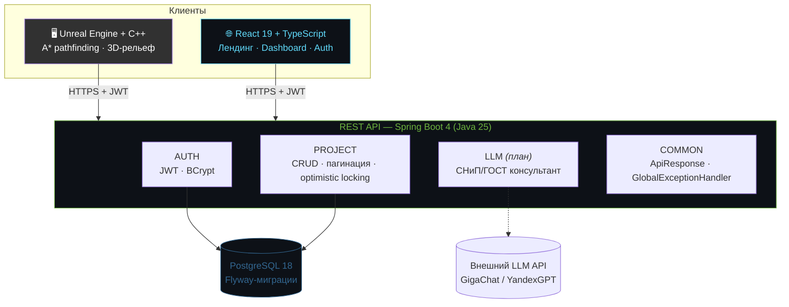

<div align="center">

# 🚄 RailOptima

**Платформа проектирования железнодорожных трасс: 3D-клиент, веб-интерфейс и единый API**

[](https://openjdk.org)
[](https://spring.io)
[](https://gradle.org)
[](https://postgresql.org)
[](https://react.dev)
[](https://typescriptlang.org)
[](https://vite.dev)
[](https://unrealengine.com)
[]()

[Быстрый старт](#-быстрый-старт) · [Архитектура](#-архитектура) · [Стек](#-технологический-стек) · [API](#-api) · [Roadmap](#-roadmap)

</div>

---

## 💡 О проекте

**RailOptima** — связка из трёх продуктов на одном бэкенде:

| Клиент | Технологии | Назначение |
|---|---|---|
| 🖥️ **Десктоп-клиент** | Unreal Engine 5 + C++ | 3D-проектирование трассы: загрузка рельефа, A\*-поиск оптимального пути, расчёт стоимости по типу грунта и уклону |
| 🌐 **Веб-платформа** | React 19 + TypeScript | Регистрация, управление проектами, публичный лендинг с демонстрацией алгоритмов |
| ⚙️ **REST API** | Spring Boot 4 (Java 25) | Единый источник правды: аутентификация, хранение проектов, в будущем — LLM-консультант по СНиП/ГОСТ |

Оба клиента говорят с одним и тем же API — поэтому проект, начатый в 3D-клиенте, виден в вебе и наоборот.

---

## 🏛️ Архитектура



**Backend** — модульный монолит: `auth`, `project`, `common` изолированы, общаются через DTO-рекорды и UUID, без прямых зависимостей между модулями.

---

## 📦 Технологический стек

<details>
<summary><strong>⚙️ Backend</strong></summary>

| Компонент | Технология | Версия |
|---|---|---|
| Язык | Java (LTS) | 25 |
| Фреймворк | Spring Boot | 4.1.1 (Spring 7.0.9) |
| Сборка | Gradle (Kotlin DSL) | 9.8.0 |
| БД | PostgreSQL | 18-alpine |
| Миграции | Flyway | из Spring Boot BOM |
| Аутентификация | JWT (JJWT) | 0.13.0, TTL 2 часа |
| Хеширование паролей | BCrypt | cost factor 12 |
| OpenAPI/Swagger | springdoc-openapi | 3.x |
| ORM | Hibernate / Spring Data JPA | — |

</details>

<details>
<summary><strong>🌐 Frontend</strong></summary>

| Компонент | Технология | Версия |
|---|---|---|
| UI-библиотека | React | 19.3 |
| Язык | TypeScript | 6.0.3 |
| Сборщик | Vite (Rolldown) | 8.3 |
| Стили | Tailwind CSS | 4.3.3 |
| Серверное состояние | TanStack Query | 5.103 |
| Роутинг | TanStack Router | 1.170 |
| Клиентское состояние | Zustand | 5.0.15 |
| Формы и валидация | React Hook Form + Zod | 7.88 / 4.6.5 |
| Генерация API-клиента | Orval (OpenAPI → React Query) | 8.37 |
| 3D-визуализация | three.js + @react-three/fiber | — |
| Анимации | motion (ex-Framer Motion) | — |
| Пакетный менеджер | pnpm | 12 |

> JWT хранится **в памяти** (замыкание модуля), не в `localStorage` — снижает риск кражи токена через XSS.

</details>

<details>
<summary><strong>🖥️ Десктоп-клиент</strong></summary>

| Компонент | Реализация |
|---|---|
| Движок | Unreal Engine 5, C++ |
| Поиск пути | A\* с собственной бинарной кучей, `UpdatePriority` за O(log n) |
| Рельеф | Генерация из 16-битных PNG heightmap |
| Типы грунта | 9 типов (`ERailGroundType`): 4 базовых + 5 расширенных |
| Формула стоимости | `Длина × (1 + \|Уклон\| × 0.1) × Коэф_грунта × (1 + 0.5 × (Угол/90)²)` |
| Ограничения | Диагонали с проверкой cut corners, запретные зоны (город, заповедник) |
| Бенчмарк | 512×512 сетка — путь найден за **66 мс** (критерий ТЗ: < 1 сек) |

</details>

---

## 📁 Структура репозитория

```text
RailOptima/
├── Backend/
│   └── src/main/
│       ├── java/api/
│       │   ├── auth/            # Регистрация, логин, JWT
│       │   ├── project/         # CRUD проектов
│       │   └── common/          # ApiResponse, GlobalExceptionHandler, SecurityConfig
│       └── resources/
│           ├── application.yml
│           └── db/migration/    # V1 — V3 Flyway-миграции
│
├── Frontend/
│   └── src/
│       ├── api/generated/       # Orval-клиент (генерируется, не коммитится)
│       ├── components/ui/       # Переиспользуемые примитивы (Button, TextField)
│       ├── features/
│       │   ├── auth/            # Формы входа/регистрации, схемы валидации
│       │   ├── landing/         # 3D-сцена, live-калькулятор стоимости
│       │   └── projects/        # Форма создания проекта
│       ├── pages/                # Landing, Login, Register, Dashboard
│       ├── routing/              # TanStack Router + защищённые маршруты
│       ├── store/                # Zustand (auth state)
│       └── lib/                  # axios-адаптер, jwt-хранилище
│
├── build.gradle.kts              # Корневой Gradle (sourceSets → Backend/src)
├── settings.gradle.kts
├── gradlew / gradlew.bat
├── docker-compose.yml             # PostgreSQL 18
├── .env.example
└── README.md
```

> **Важно:** Gradle-команды выполняются **из корня** `RailOptima/`, фронтенд-команды — **из `Frontend/`**.

---

## 🚀 Быстрый старт

### Требования

- **JDK 25**
- **Docker** + **Docker Compose**
- **Node.js 20+** и **pnpm 9+**

### 1. Клонирование и окружение

```bash
git clone <repo-url> RailOptima
cd RailOptima
cp .env.example .env
```

### 2. База данных

```bash
docker compose up -d
docker compose ps   # railoptima-db → Up
```

### 3. Backend

```bash
./gradlew bootRun
```

Проверка:
```bash
curl http://localhost:8080/actuator/health   # {"status":"UP"}
```

Swagger UI: **http://localhost:8080/swagger-ui.html**

### 4. Генерация API-клиента для фронта

```bash
cd Frontend
curl -s http://localhost:8080/v3/api-docs -o swagger.json
pnpm install
pnpm api:generate
```

### 5. Frontend

```bash
pnpm dev
```

Открыть: **http://localhost:3000**

---

## ✅ Реализовано

- [x] Регистрация и вход (JWT, BCrypt cost 12)
- [x] Защищённые маршруты на фронте (редирект на `/login` без токена)
- [x] CRUD-основа проектов: создание + список с пагинацией
- [x] Optimistic locking (`@Version`) и FK-целостность (`owner_id`)
- [x] Централизованная обработка ошибок (`GlobalExceptionHandler`)
- [x] Типобезопасный API-клиент на фронте (Orval + React Query), автогенерация из живой OpenAPI-схемы
- [x] Публичный лендинг: 3D-визуализация рельефа и маршрута, живой калькулятор стоимости по формуле из Unreal-модуля
- [x] A\*-пайфайндинг и расчёт стоимости в десктоп-клиенте (автономно, бенчмарк пройден)

## 🗺️ Roadmap

- [ ] Редактирование и удаление проекта на фронте (API-хуки уже сгенерированы)
- [ ] Детальная страница проекта
- [ ] UX для истёкшего JWT (сейчас токен тихо сбрасывается при 401)
- [ ] Интеграция Unreal-клиента с REST API (сейчас работает автономно)
- [ ] Модуль LLM-консультанта по СНиП/ГОСТ (GigaChat/YandexGPT — без VPN из РФ, без self-hosting)
- [ ] Rate limiting на API
- [ ] CI/CD

---

## 🔌 API

Полная интерактивная документация — в Swagger UI (`/swagger-ui.html`) после запуска бэкенда. Основные группы эндпоинтов:

| Группа | Эндпоинты | Доступ |
|---|---|---|
| `auth` | `POST /api/v1/auth/register`, `POST /api/v1/auth/login` | Публичный |
| `project` | `GET /api/v1/projects`, `POST /api/v1/projects`, `GET/PUT/DELETE /api/v1/projects/{id}` | Требует JWT |

Все ответы — единый конверт `ApiResponse<T>` (`success`, `message`, `data`, `timestamp`).

---

## 🔐 Безопасность

- `.env` никогда не коммитится — в репозитории только `.env.example`
- Пароли — BCrypt, cost 12
- JWT — stateless, TTL сокращён до **2 часов** (снижает риск использования токена с устаревшей ролью)
- Пагинация ограничена (`max-page-size: 100`) — защита от DoS через `?size=999999`
- CORS настраивается через `CORS_ALLOWED_ORIGINS` в `.env`

Перед реальным деплоем — сгенерировать новые секреты:
```bash
openssl rand -base64 32   # JWT_SECRET
openssl rand -hex 16      # POSTGRES_PASSWORD
```

---

## 📄 Лицензия

<div align="center">

Сделано с 🚂 командой RailOptima

</div>
